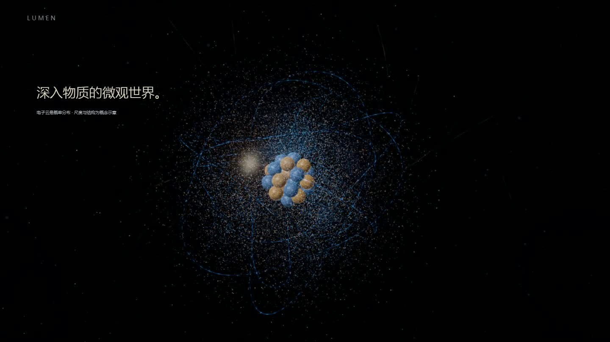

# Vibe知识大赏

**Vibe Coding × Three.js × WebGL｜用代码制作沉浸式科学可视化短片。**

> 光从哪里来？从原子跃迁到恒星辐射，用 10 个连续镜头讲述光的物理世界。

这是一个开源的 **Vibe 知识大赏 / AI 辅助创意编程 / WebGL 科普动画** 实践作品。通过 Three.js、GLSL 着色器与统一时间轴，直接在浏览器中实时渲染三维镜头，而非拼接图片或预录视频。适合想学习 **Three.js 动画、程序化视觉、科普短片制作及 Vibe Coding 工作流** 的开发者参考。

**关键词**：Vibe知识大赏、光的诞生、Vibe Coding、Three.js、WebGL2、GLSL、GSAP、Creative Coding、Science Visualization、AI-assisted Coding。

一部由浏览器实时渲染的三维科学短片：170 秒，10 个连续镜头，从光核与原子跃迁，到电磁场、色散、恒星和地球。

基于 **Three.js / WebGL2 / GLSL / GSAP / TypeScript / Vite**。网页中的三维场景实时计算，不以视频或静态分镜替代动画。



**[下载完整版 MP4](https://github.com/shij8396/vibe-knowledge-awards/releases/latest)** · [纹理来源与署名](public/textures/SOURCES.md)

## 本地运行

建议 Node.js 24 LTS。

```sh
git clone https://github.com/shij8396/vibe-knowledge-awards.git
cd vibe-knowledge-awards
npm install
npm run dev
```

开发地址：`http://127.0.0.1:5173/`。

```sh
npm test
npm run build
npm run preview
```

生产预览：`http://127.0.0.1:4173/`。需要支持 WebGL2 的浏览器。不支持时页面显示提示。

## 观看方式

打开即播放。暂停、继续、重播、全屏和进度定位通过极简控制条完成；闲置时控制条自动隐藏。空格切换播放，方向键定位。程序化氛围音需手动开启；发布页的 MP4 保留字幕，没有音轨。

## 10 个镜头

| 时间 | 镜头 |
| --- | --- |
| 0–12 秒 | 黑暗中的第一束光 |
| 12–27 秒 | 进入微观原子世界 |
| 27–45 秒 | 能量激发与电子跃迁 |
| 45–58 秒 | 追随光子的释放 |
| 58–76 秒 | 光的波动与量子特征 |
| 76–90 秒 | 光速与地月距离 |
| 90–110 秒 | 玻璃棱镜与连续光谱 |
| 110–135 秒 | 恒星核心、能量传输与光球层 |
| 135–155 秒 | 光照亮地球 |
| 155–170 秒 | 首尾呼应与 LUMEN 结尾 |

## 工程结构

- `src/core/`：单一渲染器、统一全局时间轴、摄影机样条路径、场景管理。
- `src/scenes/`：粒子流场、原子、传播、电磁场、棱镜、恒星和地球。
- `src/shaders/`：程序化材质、GPU 粒子变换、光束和表面细节。
- `src/utils/`：光路、物理关系、确定性随机与时间采样。
- `tests/`：物理计算、光路、时间轴与恒星过程的数值检查。
- `public/textures/`：本地地球、月球、云层纹理及独立署名。

统一 RAF 推动绝对时间；GSAP 时间轴由主循环采样，支持反向定位与重播。场景使用有限资源池并提前预热，退出页面时释放。批量 Points / BufferGeometry / InstancedMesh 避免逐粒子创建对象。移动设备采用较低像素比与后期质量，低帧率时动态调整分辨率。

## 科学表达边界

这是科学可视化作品，包含艺术化尺度与时间压缩：

- 光核、光子脉冲和可见光迹是视觉符号；不表示光子是实体发光球或真空需要介质。
- 电子概率云采用定性分布采样；辅助能级结构不是经典电子轨道。
- 电场和磁场同相、互相垂直，并垂直于传播方向；光子不沿正弦曲线飞行。
- 探测面展示离散事件，没有双缝装置，未声称展示干涉条纹。
- 地月演示使用统一比例尺和平均距离；其他跨尺度镜头采用艺术化比例。
- 棱镜采用 Snell 定律与 N-BK7 Sellmeier 折射率；连续光谱由多个波长采样插值，显示偏折角差适度放大。
- 恒星核心通过核聚变供能，能量经辐射与对流传输，最终从光球层辐射。内部动画不是一个光子瞬间穿透恒星。

## 验证与限制

数值测试与生产构建可通过上述命令复现。此前开场闪黑和吸收光束偏心的修复记录见 [说明](docs/OPENING-ABSORPTION-FIX.md)。截图与 MP4 来自实际运行画面，构建成功不等同于所有设备视觉验收。

尚未覆盖所有手机 GPU 和低内存设备；内部散射、玻璃反射、等离子体为实时近似，不是完整物理求解。低性能设备可能自动降低分辨率。

## 开源许可

项目原创代码采用 [MIT](LICENSE) 许可。**第三方纹理不由 MIT 重新授权**，须分别遵守 [SOURCES.md](public/textures/SOURCES.md) 中的 NASA 使用政策与 CC BY 4.0 署名要求。不得暗示 NASA 或纹理作者为本项目背书。

参考分镜、第三方参考视频、个人录屏历史和本地备份未包含在开源发布中。
